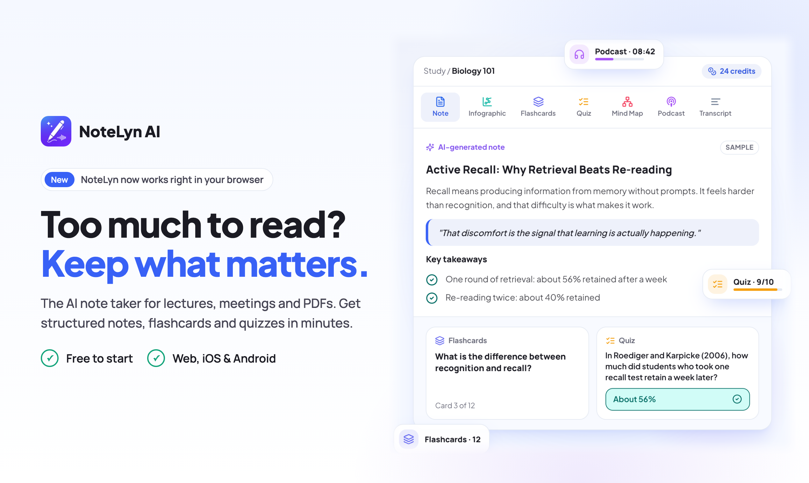
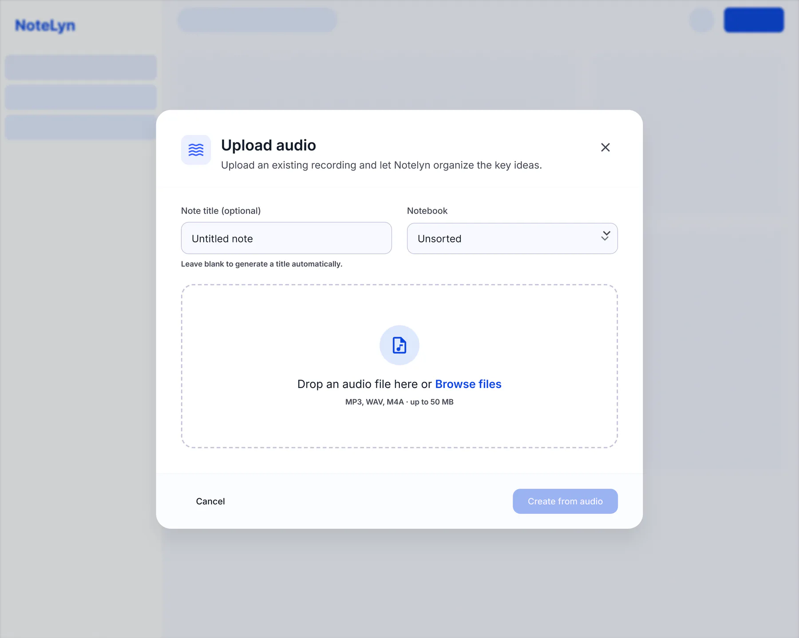
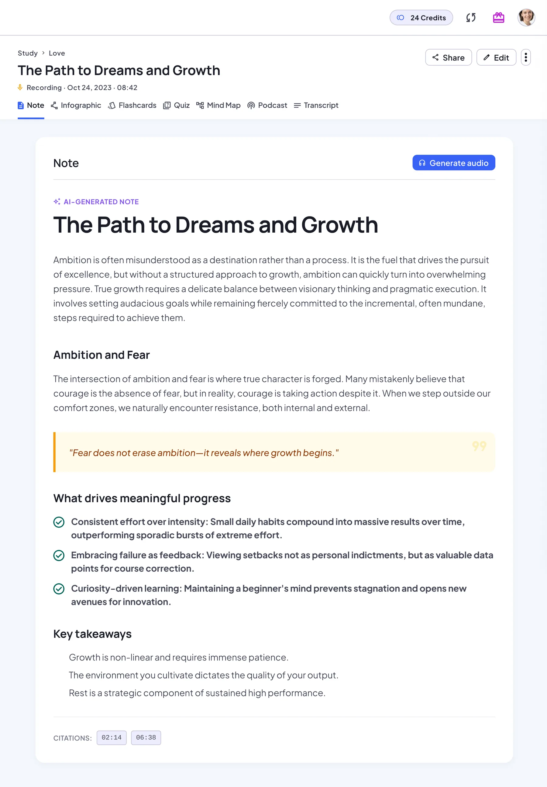
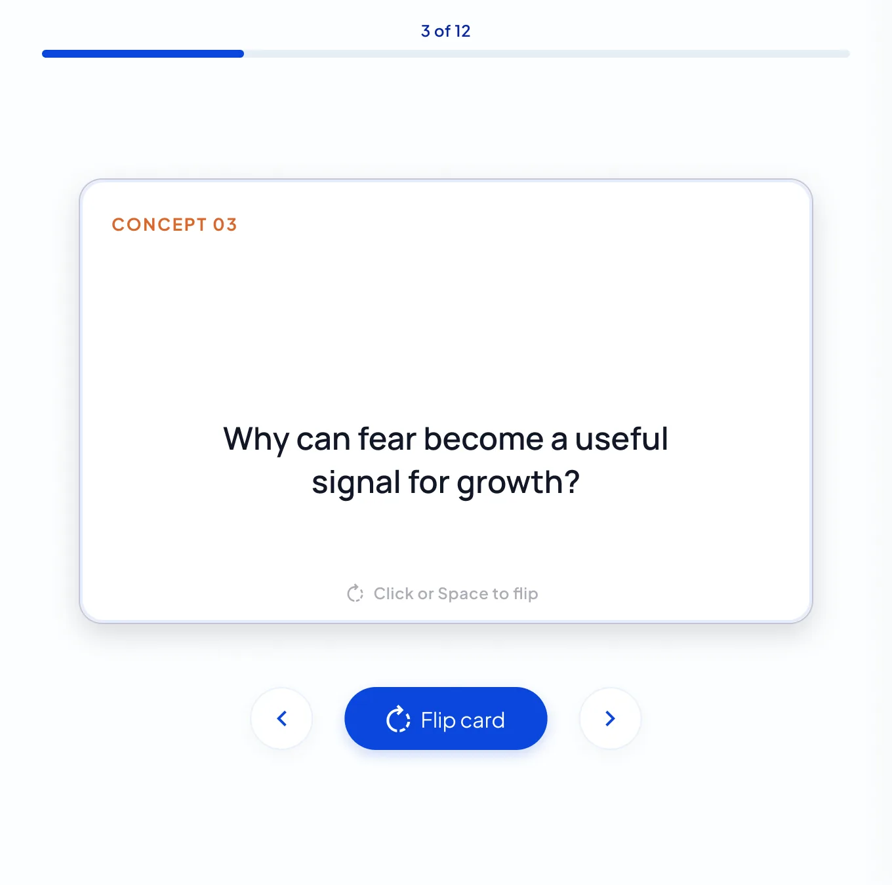
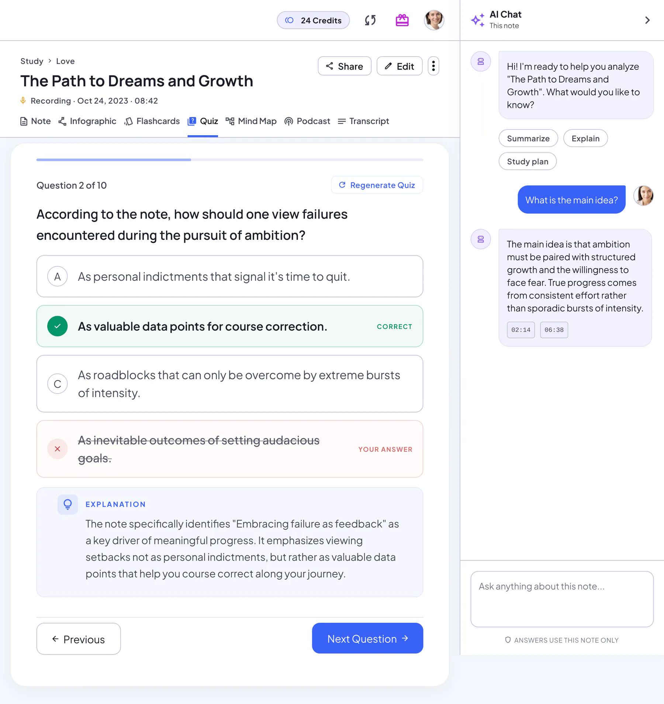
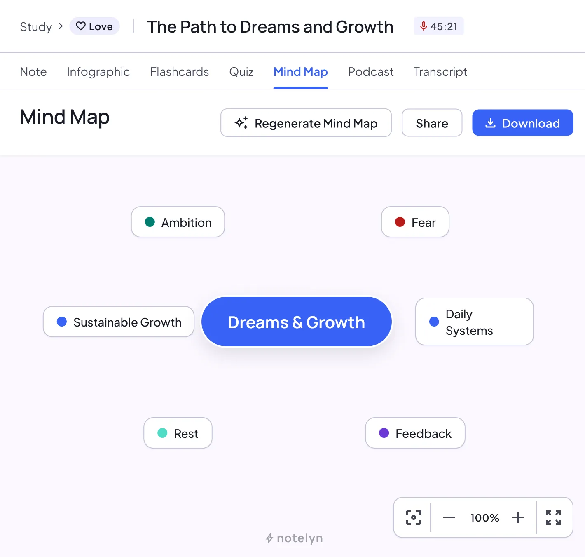
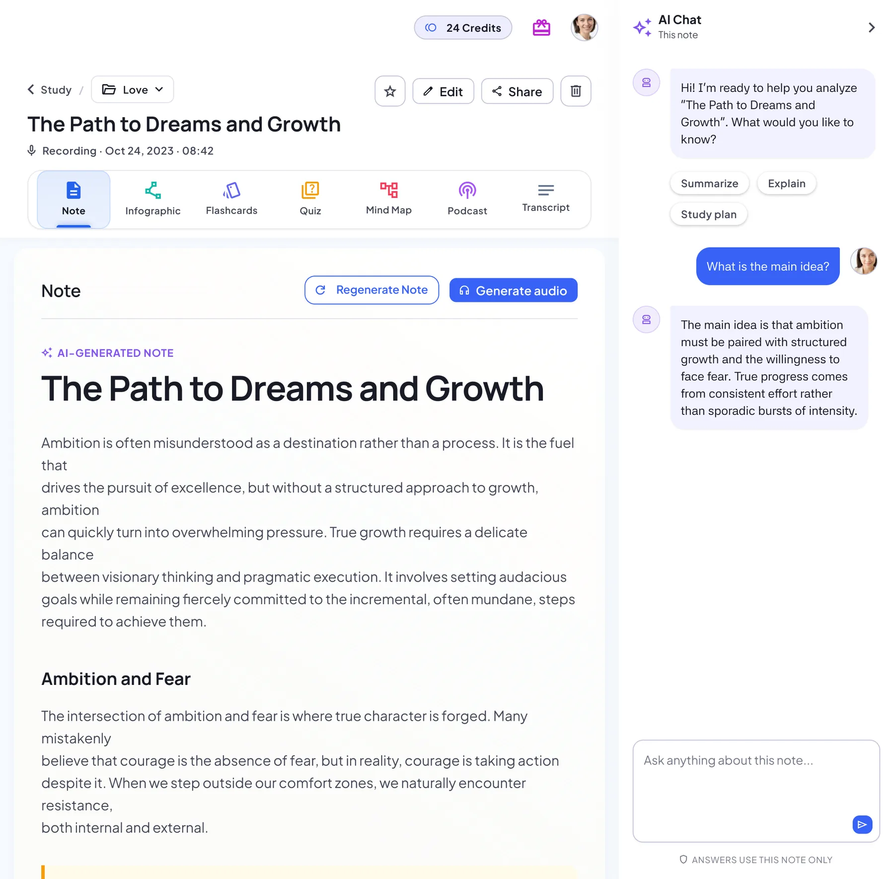
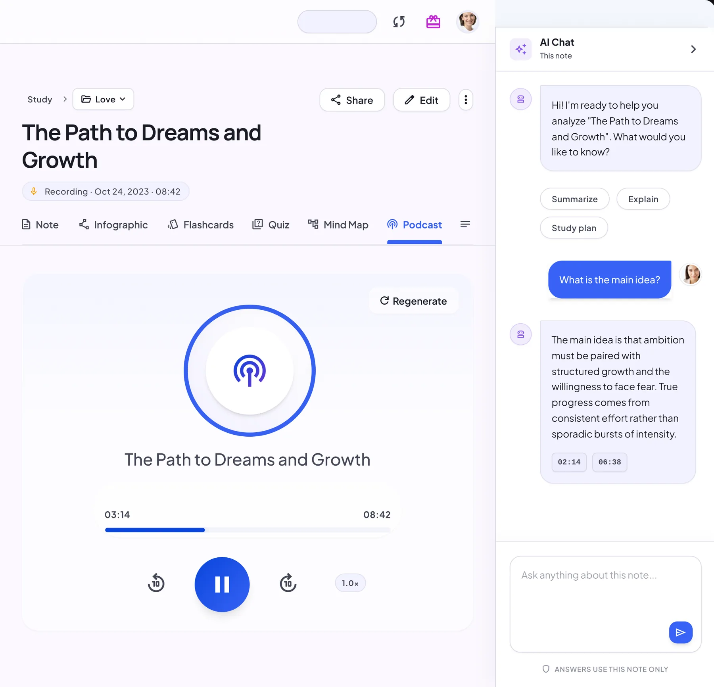
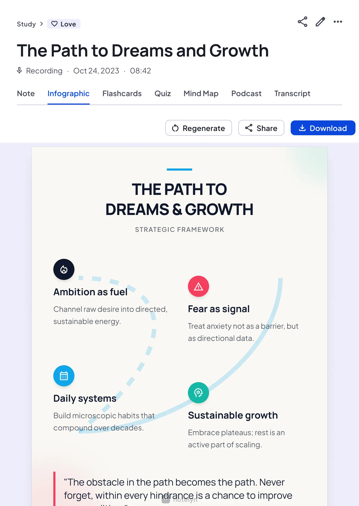

# NoteLyn AI

<p dir="ltr"><a href="README.md">English</a> · <a href="README.de.md">Deutsch</a> · <a href="README.fr.md">Français</a> · <a href="README.zh-TW.md">繁體中文</a> · <a href="README.ko.md">한국어</a> · <a href="README.pt.md">Português</a> · <a href="README.ja.md">日本語</a> · <strong>Español</strong> · <a href="README.it.md">Italiano</a> · <a href="README.ar.md">العربية</a> · <a href="README.pl.md">Polski</a> · <a href="README.he.md">עברית</a></p>

**Convierte clases y materiales de estudio en apuntes que realmente puedas usar.**

NoteLyn es una app para tomar notas con IA que convierte grabaciones, PDF, documentos, fotos y enlaces en apuntes estructurados. Revisa las ideas clave, practica con tarjetas de estudio y cuestionarios, explora un mapa mental o haz preguntas sobre el mismo apunte.

Trae una clase que necesites repasar, una lectura que quieras entender o una reunión a la que necesites dar seguimiento.

**[Crea tu primer apunte gratis →](https://app.notelyn.com/)** · [Explora un apunte de ejemplo de una clase](https://www.notelyn.com/es/samples/lecture)

**Web · iOS · Android** | **2 apuntes con IA gratis para cuentas nuevas · No necesitas tarjeta de crédito**

[Sitio web](https://www.notelyn.com/es) · [App Store](https://apps.apple.com/app/id6747017579) · [Google Play](https://play.google.com/store/apps/details?id=com.studyai.ainotetaker)



*Las imágenes son muestras ilustrativas del diseño del producto y del sitio web. El contenido, las puntuaciones y los saldos de ejemplo son solo para demostración; las distribuciones y los límites pueden variar en la app.*

Este repositorio reúne la guía de inicio de NoteLyn, flujos de trabajo prácticos, prompts y plantillas.

<a id="is-notelyn-right-for-you"></a>

## ¿NoteLyn es para ti?

Prueba NoteLyn si quieres:

- **Convertir el material que ya tienes en una sesión de estudio.** Empieza con una grabación, una lectura, una foto de tus apuntes o una lección de YouTube con subtítulos.
- **Practicar lo que necesitas recordar.** Pasa del resumen a tarjetas de estudio y preguntas de cuestionario sobre el mismo material.
- **Trabajar un tema de distintas formas.** Lee el apunte, explora su mapa mental y haz preguntas en el mismo espacio de trabajo.

Para tu primera prueba, elige una grabación corta o un PDF que conozcas bien. Revisa si el resumen capta las ideas principales, si las preguntas de práctica te ayudan a repasar y si las respuestas son útiles cuando te atascas.

<a id="create-your-first-note-in-three-steps"></a>

## Crea tu primer apunte en tres pasos

1. **Trae una fuente.** Abre la [app web](https://app.notelyn.com/) o la app móvil, inicia sesión y elige grabación, subida o importación de enlace para tu material.
2. **Revisa el apunte.** Lee el resumen y los conceptos clave. Compara los nombres, términos, números y conclusiones importantes con el original.
3. **Elige tu siguiente paso.** Genera tarjetas de estudio, haz un cuestionario, explora un mapa mental o haz una pregunta sobre el apunte. Guárdalo en una libreta para la próxima vez.

**[Pruébalo con tu propio material →](https://app.notelyn.com/)**

¿Prefieres echar un vistazo primero? [Abre un apunte de ejemplo de una clase](https://www.notelyn.com/es/samples/lecture); no necesitas cuenta para ver el ejemplo.

<a id="in-this-guide"></a>

## En esta guía

- [¿NoteLyn es para ti?](#is-notelyn-right-for-you)
- [Crea tu primer apunte en tres pasos](#create-your-first-note-in-three-steps)
- [De una clase guardada a una sesión de repaso](#from-a-saved-lecture-to-a-review-session)
- [Encuentra tu caso de uso](#find-your-use-case)
- [Qué puedes hacer con cada apunte](#what-you-can-do-with-each-note)
- [Empieza con el material que ya tienes](#start-with-the-material-you-already-have)
- [Explora el espacio de trabajo](#explore-the-workspace)
- [Compara herramientas para tu flujo de trabajo](#compare-tools-for-your-workflow)
- [Prompts y plantillas para probar](#prompts-and-templates-to-try)
- [Preguntas frecuentes](#frequently-asked-questions)
- [Comentarios y soporte](#feedback-and-support)

<a id="from-a-saved-lecture-to-a-review-session"></a>

## De una clase guardada a una sesión de repaso

Imagina que vuelves a una grabación de clase antes de un examen. Quieres las ideas principales, una forma de comprobar lo que recuerdas y ayuda con las partes que todavía no tienen sentido.

Esta es una rutina de repaso que puedes armar con un apunte de NoteLyn:

1. **Ubícate.** Lee el resumen y los conceptos clave, y luego revisa los detalles importantes contra la grabación o el material del curso.
2. **Intenta responder de memoria.** Genera tarjetas de estudio y un cuestionario de opción múltiple. Responde primero y luego lee las explicaciones.
3. **Resuelve tus dudas.** Pregunta a la IA sobre un concepto confuso y usa el mapa mental para ver cómo se relaciona con el resto del tema.

El mismo material se convierte en un recurso que puedes leer, sobre el que puedes hacer preguntas y con el que puedes practicar. [Mira un apunte de ejemplo](https://www.notelyn.com/es/samples/lecture) para ver el formato. El ejemplo ilustra la experiencia; los resultados dependen de tu material.

<a id="find-your-use-case"></a>

## Encuentra tu caso de uso

| En qué estás trabajando | Cómo te puede ayudar NoteLyn |
| --- | --- |
| **Una clase o tema de examen** | Convierte la grabación o las diapositivas en apuntes y luego practica con tarjetas de estudio y cuestionarios |
| **Un PDF, una lectura o un artículo de investigación** | Repasa los puntos principales, pregunta sobre un pasaje difícil y mapea los conceptos |
| **Una lección de YouTube** | Convierte un video con subtítulos en apuntes que puedes repasar y sobre los que puedes preguntar |
| **Una reunión o entrevista** | Revisa la transcripción y el resumen de la grabación, aclara las tareas de seguimiento y comparte el apunte |

<a id="what-you-can-do-with-each-note"></a>

## Qué puedes hacer con cada apunte

| Función | Para qué te ayuda |
| --- | --- |
| **Apuntes estructurados y resúmenes** | Empieza con una visión general organizada de las ideas principales y los conceptos clave |
| **Transcripción de audio** | Vuelve a revisar lo dicho en una grabación compatible junto a tus apuntes |
| **Tarjetas de estudio** | Practica recordar una respuesta antes de revelarla |
| **Cuestionarios con explicaciones** | Comprueba lo que entiendes con preguntas de opción múltiple y revisa por qué una respuesta es correcta |
| **Mapas mentales** | Ve las relaciones entre conceptos cuando un tema te parece desconectado |
| **Chat de IA sobre tu apunte** | Pide una explicación más sencilla, compara ideas o trabaja un pasaje específico |
| **Infografías** | Convierte las ideas clave del apunte en un resumen visual de una página que puedes descargar |
| **Podcasts** | Escucha un episodio con dos presentadores sobre el apunte; es una función de Pro que usa créditos |
| **Libretas** | Guarda juntos los materiales del mismo curso, asignatura o proyecto |
| **Compartir en modo de solo lectura** | Envía un enlace al apunte que otros pueden abrir en su navegador sin cuenta |

Usa NoteLyn en web, iOS o Android para que encaje con el lugar donde capturas y repasas tu material.

<a id="start-with-the-material-you-already-have"></a>

## Empieza con el material que ya tienes

| Fuente | Qué traer |
| --- | --- |
| **Grabación en vivo** | Una clase, reunión o entrevista que tengas permiso para grabar |
| **Archivo de audio** | Una grabación existente que quieres transcribir y convertir en apuntes |
| **PDF o documento de Word** | Lecturas del curso, diapositivas u otros documentos |
| **Imágenes** | Fotos de apuntes o diapositivas |
| **Texto** | Material escrito que quieres organizar y repasar |
| **Enlace web o de YouTube** | Una página web pública o un video de YouTube con subtítulos |

Cada apunte empieza con una sola fuente. Para una grabación de clase y sus diapositivas, crea apuntes separados y guárdalos en la misma libreta. Los formatos compatibles y los límites de archivo se muestran en la app.

<a id="explore-the-workspace"></a>

## Explora el espacio de trabajo

Sigue el camino desde una grabación hasta una sesión de repaso. Selecciona una imagen para abrirla en tamaño completo.

| **Trae tu material** | **Obtén un apunte organizado** |
| --- | --- |
| Sube una grabación existente y elige su libreta. | Revisa los encabezados, los puntos clave y las conclusiones. |
| <a href="images/capture-upload-audio.webp"></a> | <a href="images/ai-note-view.webp"></a> |

| **Practica con tarjetas de estudio** | **Comprueba lo que entiendes** |
| --- | --- |
| Recuerda una respuesta y luego voltea la tarjeta para comprobarla. | Haz un cuestionario y lee la explicación de una respuesta. |
| <a href="images/flashcards-deck.webp"></a> | <a href="images/quiz.webp"></a> |

| **Conecta las ideas** | **Pregunta sobre lo que no está claro** |
| --- | --- |
| Explora los conceptos principales como un mapa mental. | Pregunta a la IA sobre un concepto del apunte que tienes abierto. |
| <a href="images/mind-map-view.webp"></a> | <a href="images/ai-chat-panel.webp"></a> |

| **Escucha tu material** | **Revísalo visualmente** |
| --- | --- |
| Genera un episodio de podcast con dos presentadores. Necesitas Pro y créditos de podcast. | Genera una infografía de una página para repasar o descargar. |
| <a href="images/podcast-episode.webp"></a> | <a href="images/infographic-poster.webp"></a> |

Consulta la [guía de funciones de NoteLyn](https://www.notelyn.com/es/features) para ver los formatos actuales y los detalles de los planes.

<a id="compare-tools-for-your-workflow"></a>

## Compara herramientas para tu flujo de trabajo

¿Estás comparando herramientas? Empieza por cómo capturas el material y cómo quieres repasarlo. Los grupos siguientes resumen las descripciones oficiales de los productos, revisadas el 17 de octubre de 2026; no son clasificaciones de calidad de los resultados.

<a id="study-recall-and-source-based-research"></a>

### Estudio, memorización e investigación basada en fuentes

| Herramienta | Flujo de trabajo documentado | Qué comparar con NoteLyn |
| --- | --- | --- |
| **[NoteLyn](https://www.notelyn.com/es/features)** | Convierte una grabación, documento, imagen, texto o enlace compatible en un apunte y luego usa tarjetas de estudio, cuestionarios, mapas mentales, infografías, podcasts y chat. | Prueba el flujo de captura a repaso con tu propio material. Cada apunte empieza con una sola fuente; los podcasts requieren Pro y créditos. |
| **[Gemini Notebook / NotebookLM](https://support.google.com/gemininotebook/answer/16179559?hl=en)** | Selecciona fuentes del cuaderno, haz preguntas y recibe respuestas con citas de las fuentes; las [herramientas de estudio](https://support.google.com/gemininotebook/answer/16958963?hl=en) incluyen tarjetas de estudio y cuestionarios. | La selección de fuentes, el trabajo con varios materiales y el seguimiento de las respuestas hasta sus citas. |
| **[Quizlet](https://help.quizlet.com/hc/en-us/articles/360030841732-Studying-on-Quizlet)** | Estudia con tarjetas de estudio y actividades de práctica, o convierte los apuntes subidos en guías de estudio y exámenes de práctica. | Los formatos de práctica, los conjuntos de estudio que ya tienes y qué tan bien las preguntas generadas coinciden con lo que necesitas aprender. |
| **[Coconote](https://coconote.app/)** | Convierte grabaciones o archivos subidos en apuntes, transcripciones, chat, tarjetas de estudio, cuestionarios, juegos de estudio y podcasts. | Usa el mismo material para comparar la experiencia de estudio, las opciones de importación y los límites actuales de los planes. |

<a id="digital-notebooks-and-workspaces"></a>

### Cuadernos digitales y espacios de trabajo

| Herramienta | Flujo de trabajo documentado | Qué comparar con NoteLyn |
| --- | --- | --- |
| **[Notion AI](https://www.notion.com/help/ai-meeting-notes)** | Guarda el trabajo en páginas de un espacio de trabajo y usa AI Meeting Notes para transcripciones, puntos clave y tareas pendientes. | Cuánto necesitas un espacio de trabajo más amplio alrededor de tus apuntes; revisa las opciones de captura de reuniones y la elegibilidad del plan. |
| **[Goodnotes](https://www.goodnotes.com/ai)** | Trabaja con escritura a mano y documentos, y luego usa búsqueda con IA, resúmenes, herramientas de conversión de escritura a texto y cuestionarios generados. | Qué tanto de tu aprendizaje empieza con material escrito a mano o anotado, y qué herramientas de IA incluye tu plan. |
| **[Notability](https://notability.com/)** | Combina apuntes escritos a mano o tecleados con transcripción de audio y resúmenes, cuestionarios y tarjetas de estudio con IA. | Tu rutina de tomar apuntes y grabar, y después qué tan natural te resulta convertir esos apuntes en material de repaso. |

<a id="meeting-assistants"></a>

### Asistentes para reuniones

| Herramienta | Flujo de trabajo documentado | Qué comparar con NoteLyn |
| --- | --- | --- |
| **[Otter](https://help.otter.ai/hc/en-us/articles/4425393298327-Otter-Notetaker-Overview)** | Conecta un calendario y deja que Notetaker se una a Zoom, Google Meet o Teams para grabar, transcribir y resumir reuniones. | La integración con el calendario y la captura automática de reuniones. El flujo de NoteLyn aquí empieza con una grabación o subida que tú inicias. |

Las tarjetas de estudio, los cuestionarios, el chat con IA y los resúmenes de reuniones están disponibles en varias herramientas. **Prueba NoteLyn si quieres capturar tu material y pasar entre apuntes escritos, resúmenes visuales, preguntas y práctica en el mismo espacio de trabajo de apuntes.** Las funciones varían según el plan, la plataforma y la cuenta; revisa la disponibilidad actual antes de elegir.

<a id="prompts-and-templates-to-try"></a>

## Prompts y plantillas para probar

Estos prompts son sugerencias para el chat de IA del apunte actual. Las plantillas son texto sin formato que puedes copiar en tu registro de estudio o en el registro de tu reunión.

<a id="understand-a-difficult-concept"></a>

### Entiende un concepto difícil

> Explica [concepto] de este apunte con un lenguaje sencillo. Da un ejemplo simple y luego hazme una pregunta para comprobar mi comprensión.

<a id="prepare-for-a-review-session"></a>

### Prepárate para una sesión de repaso

> Sugiere cinco preguntas que deba poder responder después de estudiar este apunte. Concéntrate en los conceptos principales e indícame las secciones relevantes.

<a id="clarify-meeting-follow-ups"></a>

### Aclara las tareas de seguimiento de una reunión

> Enumera las decisiones y tareas de seguimiento mencionadas explícitamente en este apunte. Incluye un responsable y una fecha límite solo cuando se hayan indicado. Marca como "no especificado" lo que falte.

Compara el resultado con la fuente antes de confiar en él o compartirlo.

<details>
<summary><strong>Copia la plantilla de repaso después de clase</strong></summary>

```text
Curso / tema:
Fecha:
Enlace al apunte de NoteLyn:

Tres conceptos que debo poder explicar:
1.
2.
3.

Mi explicación con mis propias palabras:

Lo que todavía no entiendo:

Dónde revisarlo en el material original:

Preguntas que fallé en las tarjetas de estudio o el cuestionario:

Qué repasar en mi próxima sesión:
```

</details>

<details>
<summary><strong>Copia la plantilla de seguimiento de reunión</strong></summary>

```text
Reunión:
Fecha:
Enlace al apunte de NoteLyn:

Decisiones confirmadas:

Tarea de seguimiento:
- Tarea:
- Responsable (o "no especificado"):
- Fecha límite (o "no especificado"):

Preguntas abiertas:

Detalles comprobados contra la grabación:
```

</details>

<a id="frequently-asked-questions"></a>

## Preguntas frecuentes

<details>
<summary><strong>¿En qué se diferencia NoteLyn de NotebookLM?</strong></summary>

NoteLyn convierte una grabación, documento, imagen, texto o enlace compatible en un apunte individual con resúmenes, tarjetas de estudio, cuestionarios y mapas mentales. [Gemini Notebook / NotebookLM de Google](https://support.google.com/gemininotebook/answer/16179559?hl=en) te permite seleccionar fuentes del cuaderno, hacer preguntas y recibir respuestas con citas de las fuentes, además de usar [herramientas de estudio](https://support.google.com/gemininotebook/answer/16958963?hl=en). Compara la organización de las fuentes, la verificación de las respuestas con el material y la rutina de repaso que prefieres.

</details>

<details>
<summary><strong>¿En qué se diferencia NoteLyn de Quizlet?</strong></summary>

NoteLyn combina grabaciones e importaciones compatibles con apuntes estructurados, tarjetas de estudio, cuestionarios, mapas mentales y preguntas sobre el apunte actual. [Quizlet](https://help.quizlet.com/hc/en-us/articles/360030841732-Studying-on-Quizlet) ofrece conjuntos de tarjetas de estudio, actividades de estudio y guías de estudio y exámenes de práctica generados a partir del material del curso. Ambos permiten practicar; compara cómo capturas el material, cómo lo organizas y cómo lo usas en una sesión de estudio.

</details>

<details>
<summary><strong>¿Puedo probar NoteLyn gratis?</strong></summary>

Sí. [NoteLyn actualmente ofrece](https://www.notelyn.com/es/features) 2 apuntes con IA gratis para cuentas nuevas, sin necesidad de tarjeta de crédito. Crear un apunte requiere una cuenta. Revisa la app para ver las cuotas actuales, los planes de pago y los precios; los podcasts son una función de Pro que usa créditos.

</details>

<details>
<summary><strong>¿Puedo importar un video de YouTube sin subtítulos?</strong></summary>

La importación de enlaces de YouTube usa los subtítulos del video, así que los videos sin subtítulos no se pueden procesar de esta forma. Si tienes un archivo de audio que puedas usar, elige la subida de audio.

</details>

<details>
<summary><strong>¿Puedo combinar una grabación y diapositivas en un mismo apunte?</strong></summary>

Cada apunte empieza con una sola fuente. Crea apuntes separados para la grabación y las diapositivas, y luego organízalos en la misma libreta.

</details>

<details>
<summary><strong>¿Sobre qué responde el chat de IA?</strong></summary>

El chat de IA trabaja con el apunte que tienes abierto. Pídele que explique un concepto, compare ideas, aclare un pasaje o sugiera preguntas de repaso. Señala un término o sección específicos para obtener una respuesta enfocada.

</details>

<details>
<summary><strong>¿Las personas necesitan una cuenta para abrir mi apunte compartido?</strong></summary>

No. Un enlace de solo lectura se abre en el navegador sin iniciar sesión, y quienes lo reciben no pueden editar tu apunte original. Revisa el contenido antes de compartir el enlace.

</details>

<details>
<summary><strong>¿Puedo exportar los apuntes como archivos?</strong></summary>

La exportación de apuntes como archivo no está disponible actualmente. Puedes compartir un apunte mediante un enlace de solo lectura. Las opciones de descarga para cada tipo de contenido se muestran en la app.

</details>

<details>
<summary><strong>¿Debo revisar el contenido generado por IA?</strong></summary>

Sí. Comprueba los nombres, la terminología, los números, las fechas y las conclusiones importantes contra tu fuente. Para tus trabajos del curso, verifica las respuestas con los materiales de tu curso.

</details>

<details>
<summary><strong>¿Este repositorio incluye el código fuente de la app?</strong></summary>

Este repositorio contiene guías, prompts y plantillas. El código fuente de la app y del sitio web de NoteLyn no está incluido.

</details>

<a id="feedback-and-support"></a>

## Comentarios y soporte

¿Encontraste un error en esta guía o tienes un flujo de trabajo que sugerir? Abre un issue en este repositorio con el contexto y la mejora que te gustaría ver.

Para preguntas sobre tu cuenta, suscripción o soporte privado, escribe a [support@notelyn.com](mailto:support@notelyn.com). Mantén las contraseñas, los datos de pago y el contenido privado de tus apuntes fuera de los issues públicos.

**¿Tienes una clase, documento o grabación esperando? [Crea un apunte de NoteLyn y prueba una sesión de repaso →](https://app.notelyn.com/)**

[Más guías en el blog](https://www.notelyn.com/es/blog) · [Política de privacidad](https://www.notelyn.com/es/privacy-policy) · [Condiciones del servicio](https://www.notelyn.com/es/terms-of-service)
